# Learning engine (v2)

How Woordkast decides **what to ask**, **how to ask it**, and **what an answer does** to a word.

All learning rules live in one pure module, [`src/lib/learningEngine.ts`](../src/lib/learningEngine.ts). Every tunable number is in [`src/lib/learningConfig.ts`](../src/lib/learningConfig.ts). Screens call the engine and contain no learning rules of their own. For the design history and the decisions behind each rule, see [`LEARNING_ENGINE_PLAN.md`](../LEARNING_ENGINE_PLAN.md).

---

## 1. The five rules

| # | Rule | Where it is enforced |
|---|---|---|
| 1 | **A session grades each word once.** A missed word is asked again in the session's review queue, but those re-asks are logged ungraded. | `sessionQueue.ts`, `gradeWord` (`practice: true` on review answers) |
| 2 | **One graded result per word per local calendar day.** Later answers that day are logged, but change nothing. | `gradeWord` (`lastGradedDay !== today`) |
| 3 | **A failed word comes back the next calendar day at the earliest.** | `applyFailure` (`RESET_INTERVAL_DAYS = 1`) |
| 4 | **Flashcards are exposure, not evidence.** | `gradeWord` (`exerciseType !== "flashcard"`) |
| 5 | **Learned needs spaced evidence:** correct answers on ≥ 3 distinct days, at least one of them a production, and an interval of ≥ 7 days. | `applyCorrect` (promotion check) |

One more guard follows from these: a **correct answer on a word that isn't due yet** (pulled forward to fill a session) is not graded. An early **miss** is graded, because it is real evidence.

---

## 2. Architecture

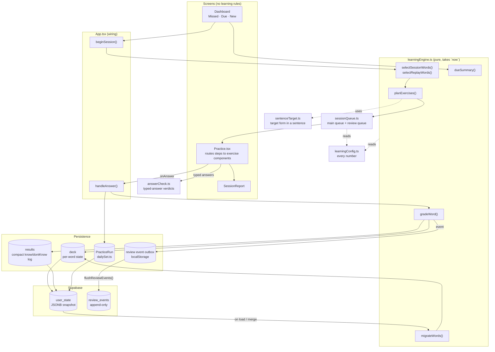

**Source of truth.** The per-word state in the deck is the operational truth. `review_events` is an audit and research log: it is never read back to change a word.

---

## 3. The word record

Every word carries its own learning state (`Word` in `learningEngine.ts`).

| Field | Meaning |
|---|---|
| `state` | `new` · `learning` · `learned` (the only states a learner sees) |
| `interval` | Days from the last graded review to the next. 0 while New. Capped at 180. |
| `ease` | Starts at 2.3, range 1.3–3.0. Scales the interval. |
| `dueDate` | Next review, always a **local midnight**. |
| `lastReviewedAt` / `lastGradedDay` | Time and local day of the last **graded** answer. |
| `reps` | Correct graded answers in a row. |
| `consecutiveFailures` | Failed graded answers in a row. |
| `lapses` | Failures after reaching Learning or Learned. ≥ 4 shows the **"Tricky"** tag. |
| `successfulReviewDays` | Distinct days with a correct graded answer. |
| `hasProductionSuccess` | Ever correct on Active Recall or Sentence Completion. |
| `evidenceTier` | 0–3, internal. Decides which exercises the word gets (§6). |
| `lastExerciseType` / `lastResult` | For variety, and for "Missed last time". |
| `listeningSkipped` | The last Listening was skipped, so the next exercise is not Listening. |
| `level` | Legacy 0–6, derived only for old readers (mastery bar, SQL view). Never used for decisions. |

---

## 4. Life of a word

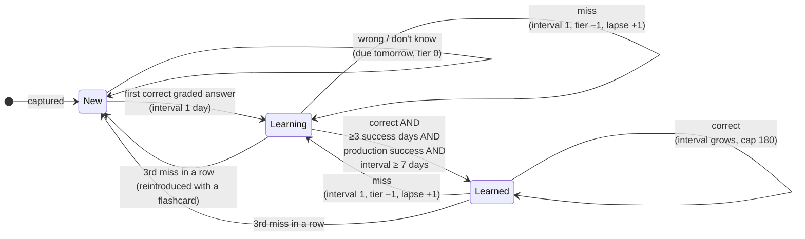

When a word drops back, its earlier evidence (`successfulReviewDays`, `hasProductionSuccess`) is **kept**, so it needs fewer days to be promoted again.

---

## 5. What one answer does: `gradeWord`

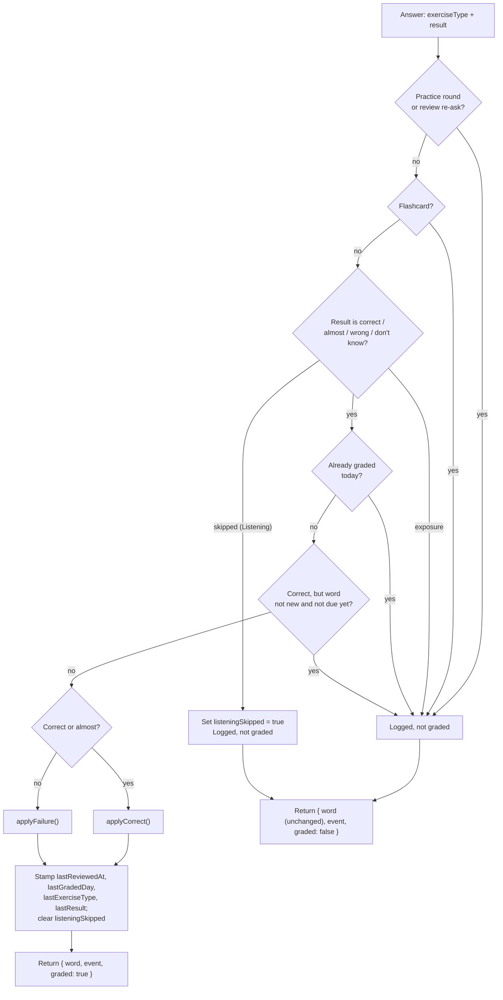

Every answer produces a **review event**, graded or not. Only graded answers are also appended to the compact `results` log (`correct`/`almost` → `know`, `wrong`/`dont_know` → `dontKnow`), which the habit, the reflection and "New today" read.

### 5.1 Correct answers: interval growth

Each exercise gives a kind of evidence, and stronger evidence earns a longer gap:

| Evidence | Exercises | Multiplier |
|---|---|---|
| Recognition | Multiple Choice, Matching, Listening, **and any "almost"** | × 1.4 |
| Contextual | Sentence Completion | × 1.8 |
| Production | Active Recall | × 2.3 |

```
elapsed  = calendar days since the last graded review (actual, not scheduled)
raw      = round(elapsed × multiplier × ease / 2.3)
interval = min(180, max(previous interval + 1, raw))
dueDate  = local midnight, `interval` days from today
```

- Using the **actual** elapsed days means an early review earns little and a late one earns more. The `interval + 1` floor guarantees growth.
- A **New** word's first correct answer skips the formula: it becomes Learning with interval 1.
- Ease rises by +0.05 only on a fully correct **production** answer. Other correct answers leave it alone.
- `evidenceTier` goes up by one when the exercise's own tier (recognition = 1, context/production = 2) is at least the word's current tier. Max 3.

### 5.2 Failed answers

| | Wrong | I don't know |
|---|---|---|
| Ease | −0.20 | −0.10 (an honest miss) |
| Due | tomorrow (local midnight) | tomorrow |
| `reps` | 0 | 0 |

Then, depending on the word:

- **New** → stays New, tier 0, back tomorrow with its flashcard intro.
- **3rd failure in a row** → back to New, tier 0, lapse +1.
- **Otherwise** → Learning, interval 1, tier −1 (minimum 1), lapse +1.

### 5.3 Worked example

A word answered correctly on every visit:

| Day | Tier before | Exercise | Calculation | State after | Interval | Next due |
|---|---|---|---|---|---|---|
| 1 | 0 | Flashcard intro, then Multiple Choice ✔ | first correct | Learning | 1 | day 2 |
| 2 | 1 | Multiple Choice ✔ | 1 × 1.4 = 1 → floor 2 | Learning | 2 | day 4 |
| 4 | 2 | Active Recall ✔ | 2 × 2.3 = 4.6 → 5 · ease 2.35 | Learning (interval < 7) | 5 | day 9 |
| 9 | 3 | Active Recall ✔ | 5 × 2.3 × 2.35/2.3 ≈ 11.75 → 12 | **Learned** (4 days, production, ≥ 7) | 12 | day 21 |

So the fastest path to Learned takes **4 separate days across about 9 calendar days**.

---

## 6. Which exercise a word gets: `planExercises`

### 6.1 Evidence tiers

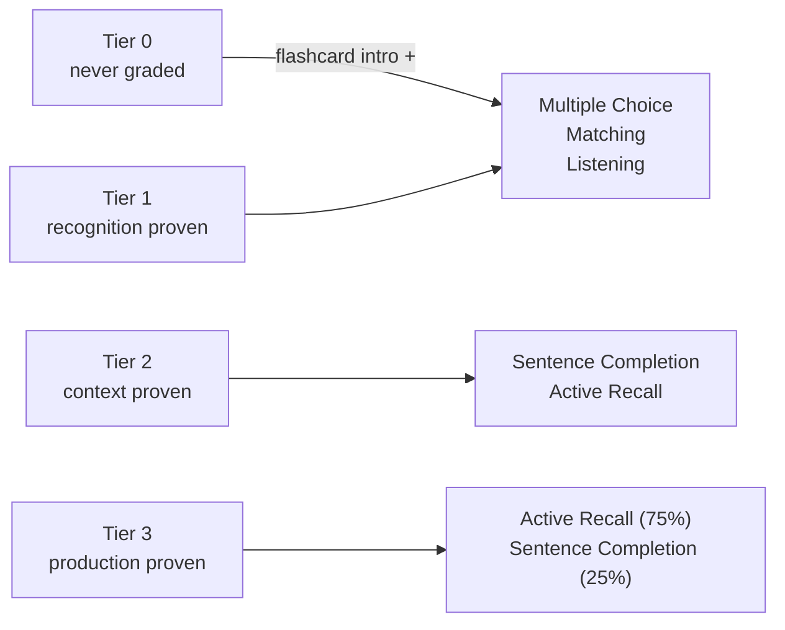

Right after a miss, the word is asked one tier lower (`exerciseTierFor`).

### 6.2 Choosing for one word

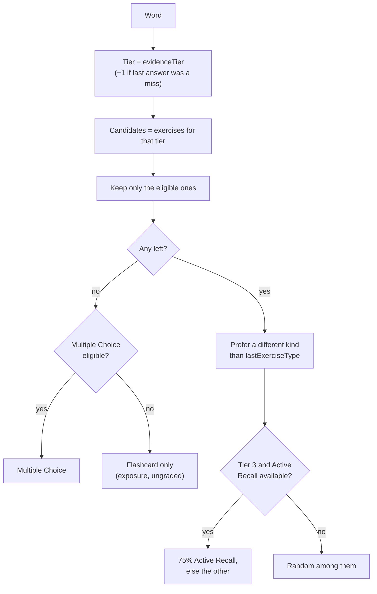

**Eligibility:**

| Exercise | Needs |
|---|---|
| Multiple Choice | 3 other deck words for distractors. A smaller deck tops up from the first 2,000 dictionary entries (same part of speech first, never synonyms). |
| Matching | A grid of 4–5 words |
| Listening | Audio setting on, audio for the word, and not skipped last time |
| Sentence Completion | A sentence where the target form appears exactly once (`sentenceTarget.ts`) |
| Active Recall | Always |

### 6.3 Building the session plan

1. Choose an exercise per word (above).
2. **Matching grid:** if fewer than 4 words drew Matching, convert enough Multiple Choice words that can match to reach 4 (preferring words whose last exercise wasn't Matching). Group into grids of 4–5; leftovers choose again without Matching.
3. **Units:** each tier-0 word gets an ungraded flashcard intro directly in front of its graded exercise. A Matching grid gets the intros of all its new words in front of it.
4. **Order:** shuffle the units, then greedily avoid two steps of the same kind in a row.

---

## 7. Which words a session asks: `selectSessionWords`

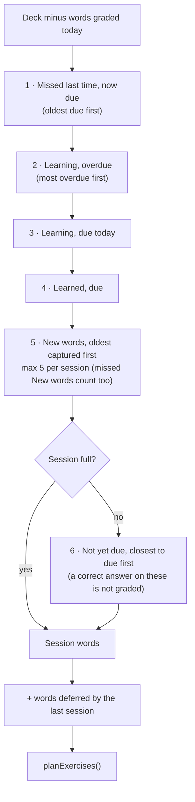

- **Session size** = the habit commitment: Espresso **10** · Ontbijt **20** · Diner **30**. On a return day (after time away) it is a **5-word warm-up**.
- A **Missed** session (from "Missed last time" on the dashboard) is priority 1 only.
- When nothing is eligible, the dashboard says *"You're done for today"*. The user can still start a **practice round** (`selectReplayWords`: today's missed words, then today's others, then the rest of the deck). It is fully ungraded.

---

## 8. Inside a session: the queue

[`sessionQueue.ts`](../src/lib/sessionQueue.ts) runs the planned steps, then re-asks missed words.

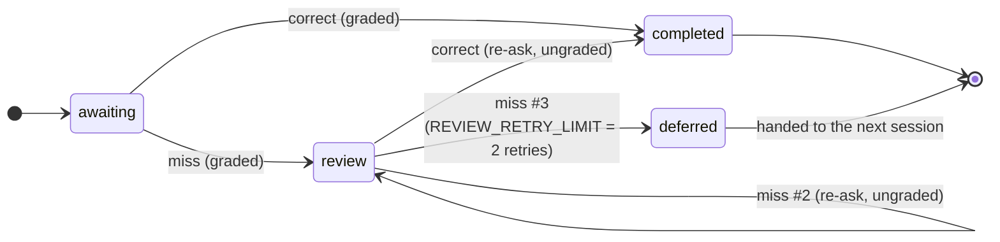

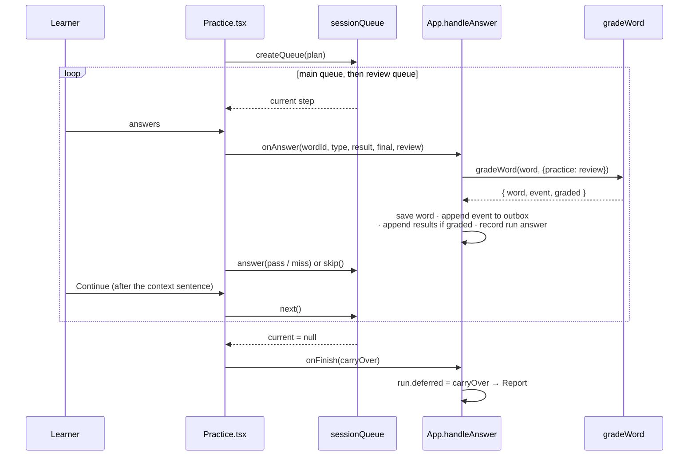

- **Progress** = completed words ÷ all words. Retries can't inflate it, and it never goes down.
- A missed **Matching** word comes back as Multiple Choice. A **skipped Listening** word is asked straight away as Multiple Choice; the skip says nothing about knowing it.
- Leaving part-way keeps every answer so far. **Continue** resumes the exact remaining steps from the saved plan. Words still waiting for review are deferred to the next session.

---

## 9. Answer checking (typed answers)

[`answerCheck.ts`](../src/lib/answerCheck.ts) is used by Active Recall and Sentence Completion.

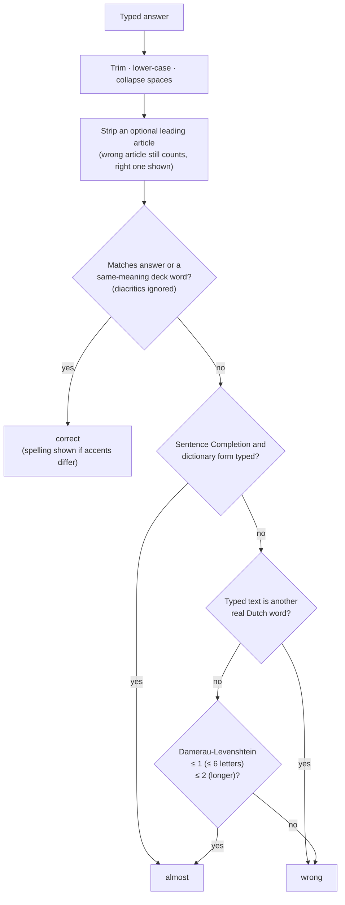

"Almost" is graded as correct, but only with the **recognition** multiplier (× 1.4) and no ease gain.

---

## 10. Days, streaks and the habit

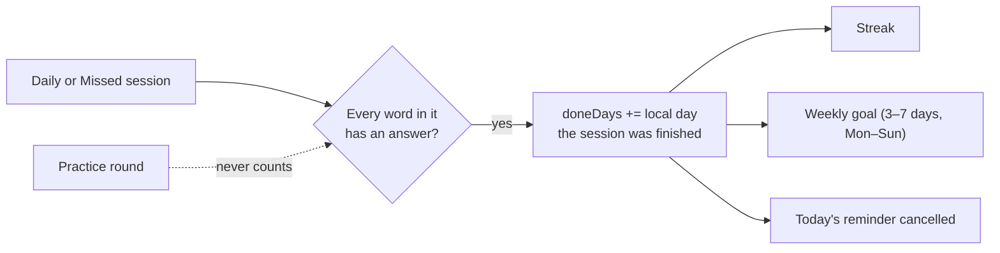

- A day is done when **one full session** is answered. Right, wrong, almost and "I don't know" all count.
- More sessions the same day are allowed while words are still eligible. They never re-ask a word graded today.

---

## 11. Storage, sync and the review log

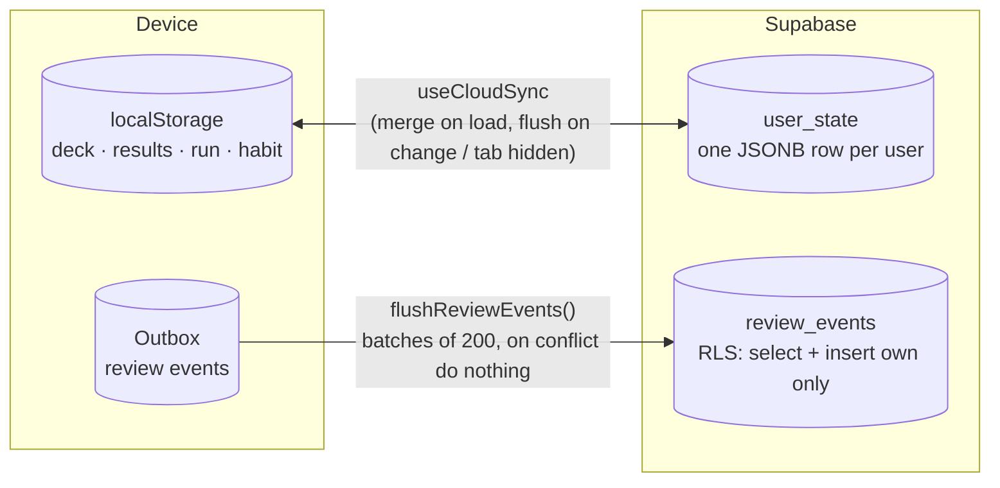

- **Offline-first.** Everything is written locally first, then synced when signed in.
- **Merging two devices:** per word, the copy with the latest `lastReviewedAt` wins, then the one with more evidence. `results` and `doneDays` are unioned. Runs are not blended: the newer day wins.
- **Review events** get a device-generated UUID, so retried flushes never duplicate rows. Each event is stamped with the user signed in at the time, and only that user's events are uploaded. Rows are never edited or deleted.

`review_events` columns: `id`, `user_id`, `word_id`, `session_id`, `occurred_at`, `local_date`, `exercise_type`, `result`, `graded`, `response_time_ms`, `state_before`, `state_after`, `interval_before`, `interval_after`, `received_at`.

---

## 12. Migration from v1

`migrateWords` runs on every local load and on every remote snapshot before it is merged. It is **idempotent**: a word with `engineVersion === 2` is returned untouched.

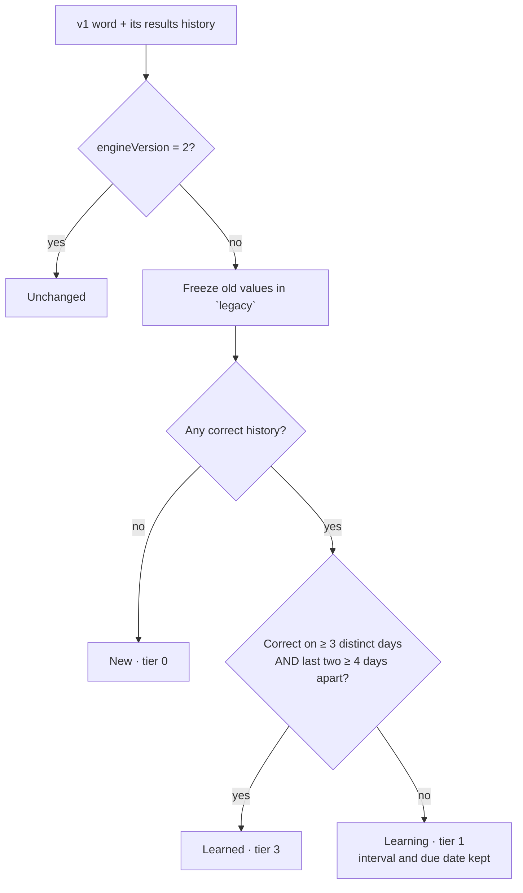

The old "mature" state alone is never enough for Learned, because old correct answers may come from same-session re-showing. **Rollback:** `restoreLegacy()` puts the frozen values back on the client, and the server keeps a pre-v2 copy of every deck in `research.user_state_backup_engine_v2`.

---

## 13. Tuning reference

All values are in [`learningConfig.ts`](../src/lib/learningConfig.ts).

| Setting | Value |
|---|---|
| Initial / min / max ease | 2.3 / 1.3 / 3.0 |
| Ease gain (correct production) | +0.05 |
| Ease penalty: wrong / don't know | −0.20 / −0.10 |
| Multipliers: recognition / contextual / production | 1.4 / 1.8 / 2.3 |
| Max interval | 180 days |
| Reset interval (after a miss, first success) | 1 day |
| Learned: success days / min interval | 3 / 7 days |
| Failures in a row before reset to New | 3 |
| New words per session | 5 |
| Multiple Choice options | 4 |
| Dictionary fill for small decks | first 2,000 entries |
| Matching grid | 4–5 words |
| Listening options | 4 |
| Tier 3 Active Recall share | 75 % |
| Typo tolerance | 1 edit (≤ 6 letters), 2 edits (longer) |
| Review retries before deferring | 2 |
| Leech ("Tricky") threshold | 4 lapses |
